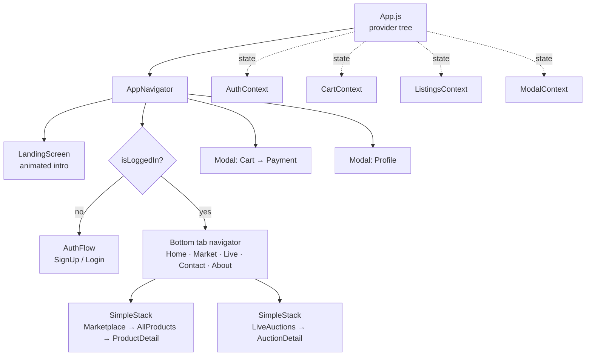
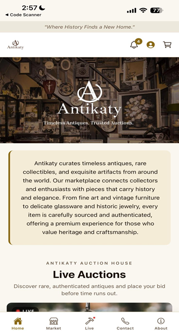
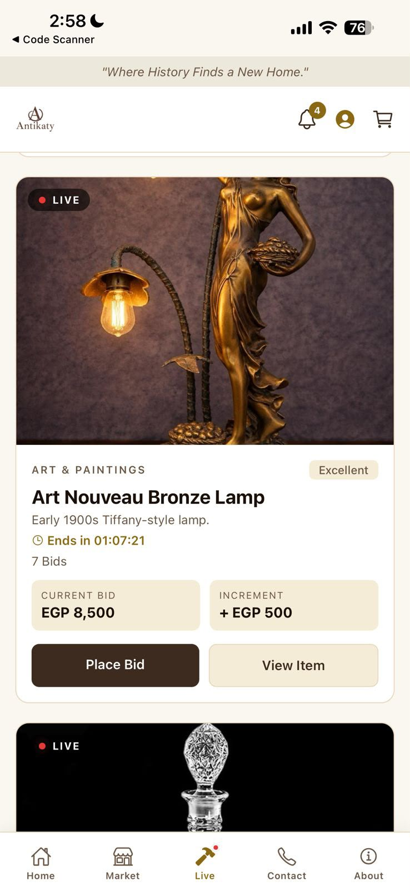
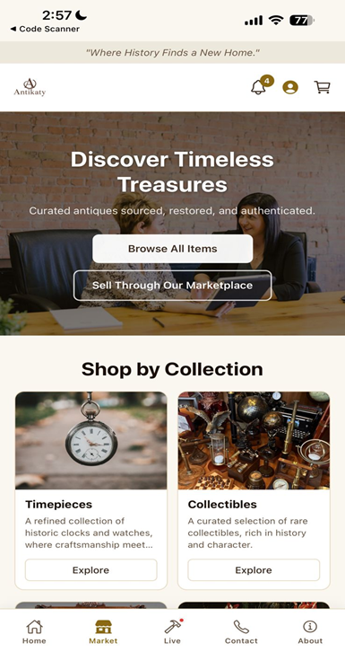
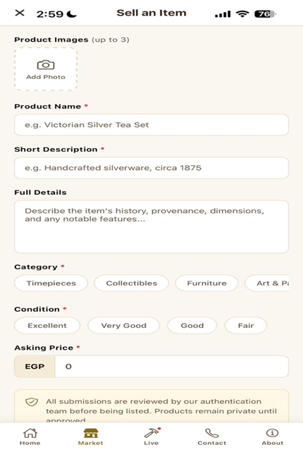

# Antikaty — Antique Auction & Marketplace Mobile App

> **Personal portfolio project · React Native (Expo)**
> Built and designed by **Khaled Anas**

Antikaty is a **mobile auction house for antiques**. Collectors browse curated collections, place bids in **live timed auctions**, buy fixed-price pieces from the **marketplace**, and submit their own antiques for **consignment review** — all in one app, with a hand-built navigation layer and an editorial, museum-inspired design system.

> 🔒 **This is a showcase repository.** The full source code lives in a private repo. Code walkthroughs are available on request for interviews.

---

## ✨ What it does

| Feature | Description |
|---|---|
| 🔨 **Live auctions** | Real-time **countdown timers**, per-lot **bid increments**, a confirm-before-bid guard, and an **animated bid-success overlay**; ended lots render as `SOLD` and lock bidding |
| 🏺 **Marketplace & catalog** | Curated collections, trending carousel, and a full catalog with a **filter sheet** for 7 categories × item condition, plus a live result count and empty state |
| 🛒 **Cart & checkout** | Quantity-aware cart with running subtotal → **multi-step checkout** (cash on delivery / card), field-level validation, processing state, and a generated order reference (`ANT-######`) |
| 📸 **Sell your antique** | Consignment flow using the **native image picker** (up to 3 photos, with permission handling), required-field validation, and submission into a `pending` review queue |
| 👤 **Profile & orders** | Personal information editing, order history, support replies, and the seller's own submitted listings — presented as a full-screen modal over the tabs |
| 🔐 **Auth gate** | **Animated landing screen** → sign-up / login flow → tabs; signing out tears down the cart and profile modals and returns the user to auth |

## 🏗️ Architecture



**Why a custom stack:** the app ships only `@react-navigation/bottom-tabs`. Instead of pulling in a second navigator, each tab that needs depth runs a **`SimpleStack`** — a ~30-line in-tab stack that holds `{name, params}` frames in state and exposes a familiar `navigate / goBack / replace / resetTo` API. The same shim intercepts `Cart` and `Profile` to raise **modal overlays** and tab names to delegate to the real tab navigator, so screens stay written against one consistent navigation contract.

## 📱 App map

| Area | Screens |
|---|---|
| Onboarding & auth | `Landing` · `SignUp` · `Login` |
| Browse | `Home` · `Marketplace` · `AllProducts` · `ProductDetail` |
| Auctions | `LiveAuctions` · `AuctionDetail` |
| Commerce | `Cart` · `Payment` |
| Account & info | `Profile` · `Contact` · `About` |

**14 screens · 5 shared components · 4 React contexts · ~6.7k lines of JavaScript**

## 🧰 Tech stack

- **Framework:** React Native 0.81 · React 19 · Expo SDK 54 (new architecture enabled)
- **Navigation:** `@react-navigation/native` + `bottom-tabs` v7, plus a custom in-tab stack and modal router
- **State:** React Context API — `Auth`, `Cart`, `Listings`, `Modals` (no external state library)
- **Native modules:** `expo-image-picker` (consignment photos) · `react-native-safe-area-context` · `expo-status-bar`
- **Animation:** React Native `Animated` (landing sequence, bid-success overlay, countdown ticks)
- **Targets:** iOS · Android · Web (`react-native-web`)

## 📸 Screenshots

| Home | Live auction |
|:---:|:---:|
|  |  |

| Marketplace | Sell your antique |
|:---:|:---:|
|  |  |

## 🔍 Code sample — the in-tab stack shim

A simplified version of the navigation layer that lets every screen use one API, whether its destination is a pushed route, a tab, or a modal:

```jsx
function SimpleStack({ screens, initialStack }) {
  const [stack, setStack] = useState(initialStack);
  const { openCart, openProfile } = useModals();
  const tabNav = useNavigation();

  const current = stack[stack.length - 1];
  const Screen = screens[current.name];

  const navigation = {
    navigate: (name, params = {}) => {
      if (name === 'Cart') return openCart();          // modal overlay
      if (name === 'Profile') return openProfile();    // modal overlay
      if (TAB_NAMES.has(name)) return tabNav.navigate(name); // real tab
      setStack(prev => [...prev, { name, params }]);   // push a frame
    },
    goBack: () => setStack(prev => (prev.length > 1 ? prev.slice(0, -1) : prev)),
  };

  return <Screen navigation={navigation} route={{ params: current.params }} />;
}
```

## 🎨 Design system

A single token file drives the whole app — serif display type over a warm, gallery-neutral palette.

| Token | Value | Used for |
|---|---|---|
| `primary` | `#3D2B1F` | Deep walnut — headers, footer, primary buttons |
| `secondary` | `#8B6914` | Antique gold — accents, active tab, badges |
| `background` | `#FAF6F0` | Aged-paper app background |
| `beige` | `#F5ECD7` | Splash and section fills |
| `border` | `#E8D9C0` | Hairline dividers and card edges |
| `textLight` | `#6B5744` | Secondary copy and metadata |

## 👨‍💻What I built

Solo project — design, architecture, and implementation:

- **Navigation layer:** custom in-tab stack + modal router over bottom tabs, with an auth gate and sign-out teardown
- **Auction mechanics:** live countdown hook, increment-based bidding with confirmation, sold/ended lot states, animated success overlay
- **Commerce flow:** cart reducer logic (dedupe, quantity deltas, subtotal), checkout with per-method validation and order references
- **Consignment flow:** native image-picker integration with permission handling, multi-field validation, and a pending-review listings store
- **Design system & UI:** color/type tokens, reusable product, collection, and trending cards, filter sheets, notification panel, and an animated brand intro

---

📫 **Khaled Anas** · [GitHub](https://github.com/khaledaanas)

© 2026 Khaled Anas. All rights reserved. This repository is for portfolio viewing only.
